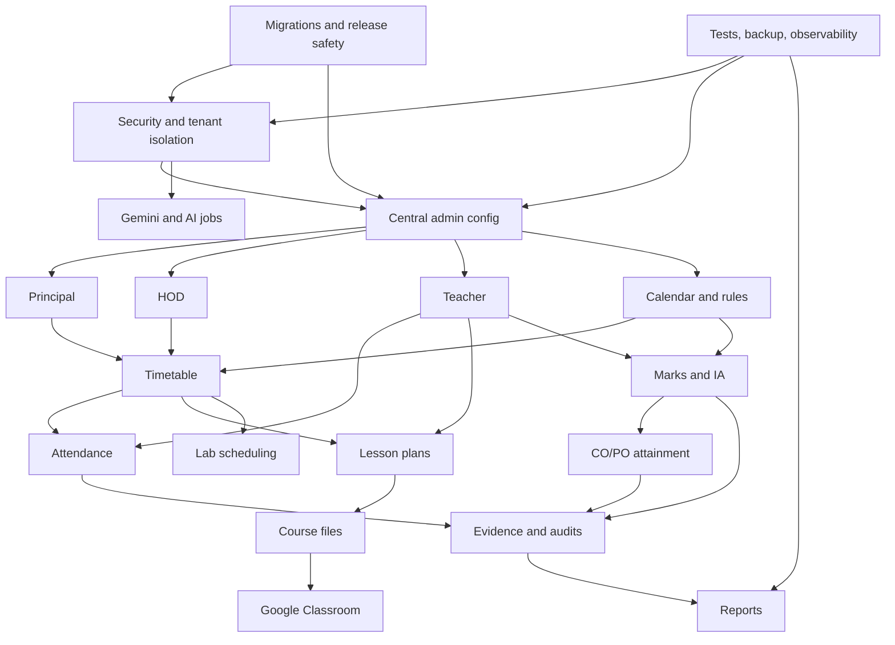

# Cravex Feature Specification Pack

**Pack version:** 1.0  
**Verified context:** 11 October 2026  
**GitHub repository:** [`ajsomapurkar/Cravex`](https://github.com/ajsomapurkar/Cravex), default branch `main`  
**Reviewed tree:** `84cb3f5d9f4fd6b60e62f0f51596efa494bdd32d`  
**Connected Supabase project:** `gkuzoywsftjxnxzlufiy` (`ap-south-1`, PostgreSQL 17)  
**Purpose:** A modular, feature-by-feature specification that the team can update and implement without conflating current foundations with production-complete behavior.

> **Safety note:** This is documentation, not a migration or deployment script. Do not run the repository's base `supabase/schema.sql` against the connected project. It includes legacy `DISABLE ROW LEVEL SECURITY` statements. No GitHub or Supabase changes were made to create this specification pack.

## How to use this pack

1. Start with [Safe Change Architecture](architecture/SAFE_CHANGE_ARCHITECTURE.md) and [Live Audit Findings](audit/LIVE_REPOSITORY_SUPABASE_AUDIT.md).
2. Implement P0 security and release-safety items before enabling real student data.
3. Implement features in the dependency order below, using each feature file's acceptance criteria as the ticket checklist.
4. Update the status in a feature file only after end-to-end behavior and tests are verified. A table, screen, or schema object alone does not count as complete.
5. Every database or Edge Function change must have a reviewed migration/source change, staging evidence and rollback/forward-fix notes.

## Status definitions

- **Existing foundation:** Code/schema/UI for some capability was observed. This is not a claim that the full workflow is complete.
- **Partial / verify:** Some logic exists, but persistence, permissions, error states, or end-to-end integration require validation.
- **Missing / not established:** No dedicated model/workflow was confirmed in the inspected repository/live public schema. Check the complete system before adding a duplicate.
- **P0:** Security/data-loss/release blocker.
- **P1:** Required core academic workflow.
- **P2:** Quality, integration, analytics or scale work after secure core flows.

## Feature index

| ID | Feature file | Priority | Current state summary |
|---|---|---|---|
| F01 | [Security, Authentication and Tenant Isolation](features/f01-security-authentication-and-tenant-isolation.md) | P0 | Critical anonymous-policy and RLS issues found |
| F02 | [Admin Console and Central Configuration](features/f02-admin-console-and-central-configuration.md) | P1 | Central authoritative configuration incomplete |
| F03 | [Principal Dashboard and Institutional Governance](features/f03-principal-dashboard-and-institutional-governance.md) | P1 | Principal absent from live role constraint |
| F04 | [HOD Department Operations](features/f04-hod-department-operations.md) | P1 | HOD UI/mapping foundation; workflows need verification |
| F05 | [Teacher Dashboard and Faculty Workspace](features/f05-teacher-dashboard-and-faculty-workspace.md) | P1 | Role-aware UI and academic tables exist; flow incomplete/unverified |
| F06 | [Timetable, Live Publishing and Schedule Propagation](features/f06-timetable-live-publishing-and-schedule-propagation.md) | P1 | Dedicated versioned timetable model not established |
| F07 | [Academic Calendar, Schemes and Regulations](features/f07-academic-calendar-schemes-and-regulations.md) | P1 | Partial academic subject fields; versioned rules not established |
| F08 | [Student Records, Enrollment and Mentoring](features/f08-student-records-enrollment-and-mentoring.md) | P1 | Student/risk foundations exist; lifecycle needs completion |
| F09 | [Attendance and Eligibility](features/f09-attendance-and-eligibility.md) | P1 | Sessions/logs exist; security and correction flow need work |
| F10 | [Internal Assessment, Marks and Approval Workflow](features/f10-internal-assessment-marks-and-approval-workflow.md) | P1 | Marks/audit foundations; workflow and public exposure need work |
| F11 | [OBE: CO, PO, PSO and Attainment](features/f11-obe-co-po-pso-and-attainment.md) | P1–P2 | CO/PO tables exist, RLS disabled on four tables |
| F12 | [Lesson Plans, Syllabus Coverage and Delivery Evidence](features/f12-lesson-plans-syllabus-coverage-and-delivery-evidence.md) | P1 | Existing tables/function; both lesson plan tables have RLS disabled |
| F13 | [Course Files, Resources, PPTs and Question Papers](features/f13-course-files-resources-ppts-and-question-papers.md) | P1 | Resource/document pipeline exists, access and review partial |
| F14 | [Meetings, Announcements, Callouts and Notifications](features/f14-meetings-announcements-callouts-and-notifications.md) | P1 | Notices/outbound message foundations exist; delivery workflow partial |
| F15 | [Google Classroom Integration and Content Linking](features/f15-google-classroom-integration-and-content-linking.md) | P2 | Dedicated mapping/sync domain not confirmed |
| F16 | [Gemini / AI Chatbot Reliability and Cost Controls](features/f16-gemini-ai-chatbot-reliability-and-cost-controls.md) | P1–P2 | Jobs/quotas/cache/provider-health foundations exist; load test required |
| F17 | [IQAC, Evidence Packs and Academic Audits](features/f17-iqac-evidence-packs-and-academic-audits.md) | P2 | Evidence Packs UI was smoke-tested; source-backed logic needs proof |
| F18 | [Analytics, Reports and Exports](features/f18-analytics-reports-and-exports.md) | P2 | Analytics UI exists; formulas and scope need verification |
| F19 | [Laboratories, Practical Batches and Resource Scheduling](features/f19-laboratories-practical-batches-and-resource-scheduling.md) | P2 | Some component/batch columns exist; full lab workflow not confirmed |
| F20 | [Supabase Migrations, Release Engineering and Change Safety](features/f20-supabase-migrations-release-engineering-and-change-safety.md) | P0 | Live/repo schema and function versions drift; migration folder not seen in inspected tree |
| F21 | [Testing, Observability, Backups and Operations](features/f21-testing-observability-backups-and-operations.md) | P0–P1 | UI smoke tests exist; backup function auth needs urgent review |

## Recommended implementation order

1. **P0 — security baseline:** F01, F20, F21 (particularly RLS/policy containment and backup endpoint authentication).
2. **P1 — central academic foundation:** F02 and F07, including scoped roles, institution structure, scheme versions and audit semantics.
3. **P1 — governance and scheduling:** F03, F04 and F06 (Principal/HOD, timetable drafts, conflict detection, approvals, publish events).
4. **P1 — daily academic delivery:** F05, F08, F09, F12 and F13 (teacher workflow, students, attendance, plans, course files).
5. **P1 — assessment controls:** F10 and its relationship to F11 (marks approval/freeze and CO mapping).
6. **P1/P2 — communication and scale:** F14, F16, F15.
7. **P2 — institution quality and insights:** F17, F18, F19.
8. Run F21 release gates for every phase, not only at the end.

## Dependency overview

## Global definition of done

- The complete happy path works in the UI and persists in Supabase.
- Every read and mutation is authorized at the database or server boundary; client-side role hiding is not authorization.
- College, department, subject, class and student scope is tested with at least two separate test colleges.
- There is a migration, staging proof, updated database types, and a rollback/forward-fix plan for every schema change.
- UI has loading, empty, denied, error, retry, and conflict states.
- No finalized marks or past attendance are silently rewritten by timetable/configuration changes.
- Relevant events are audited; notifications are reliable but are not the only persistence path.
- Current Edge Function source/version is compared before deployment; stale source snapshots are not redeployed blindly.
- Security/Performance Advisors are reviewed after schema changes; findings are resolved or individually documented.
- Feature status in this pack is updated only with linked test evidence.
